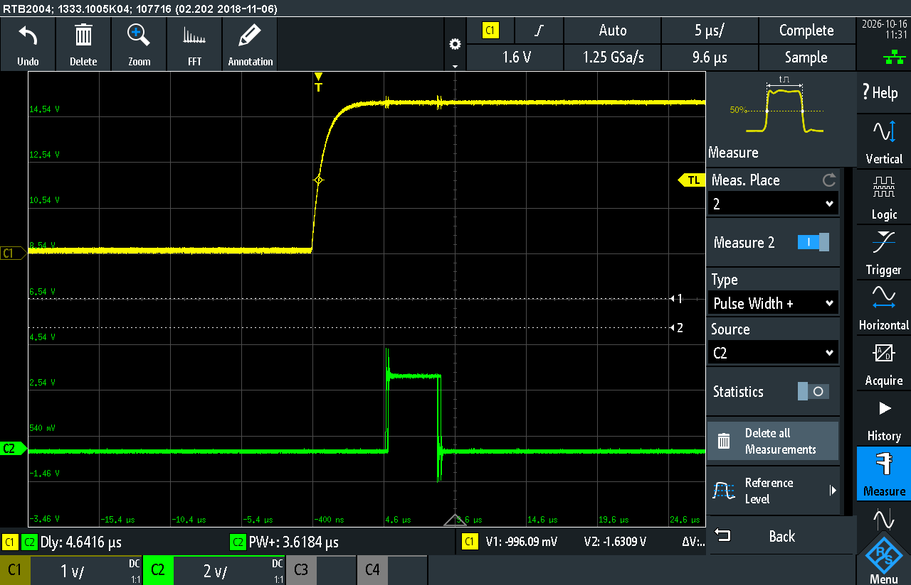
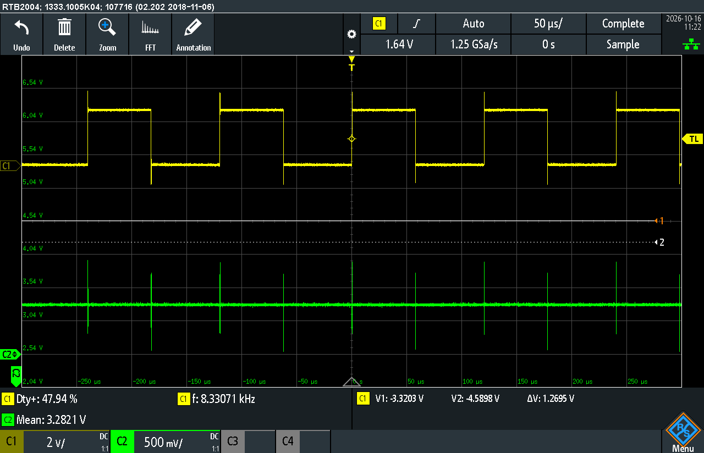
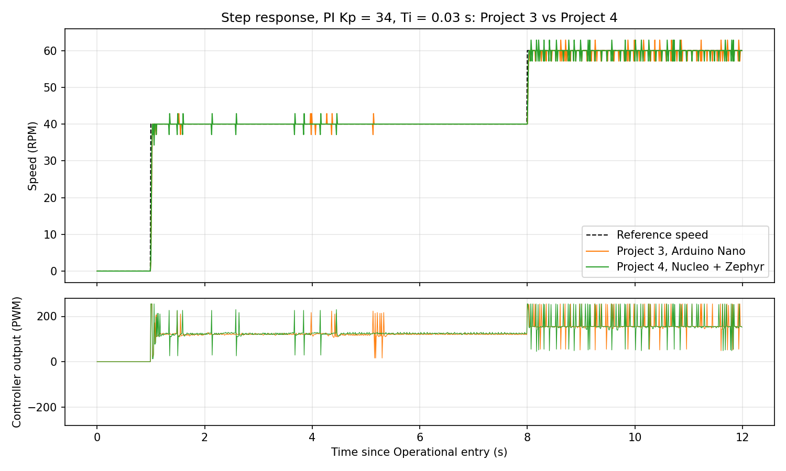
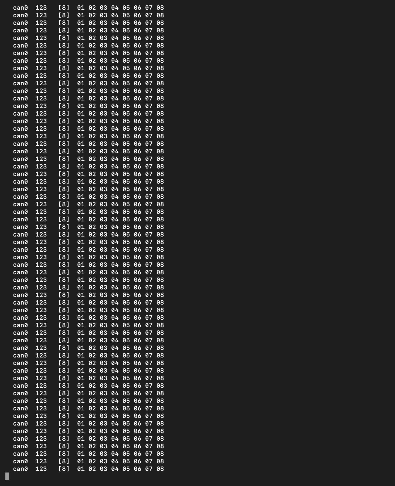
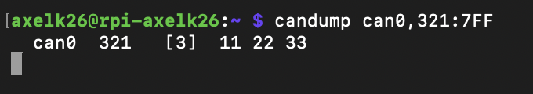
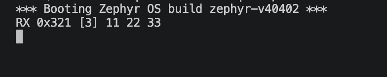
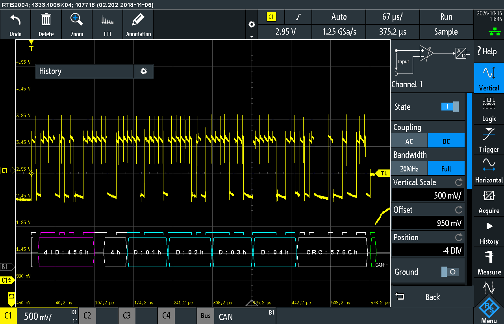
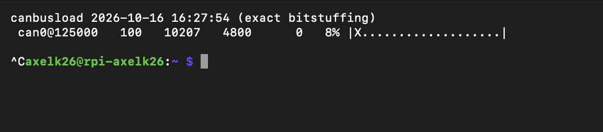

## analog_out.h

| AVR mechanism | Zephyr API | Why |
| --- | --- | --- |
| Timer_usec | uses a uint32_t for a period in nanoseconds, using built-in timer on zephyr | don't need our own timer, will use zephyr built-in timer instead |

Lines changed: +2 / -2

## analog_out.cpp

| AVR mechanism | Zephyr API | Why |
| --- | --- | --- |
| Timer and pin initialization, set_duty_cycle() and ISRs | setting the pwm directly with pwm_set_dt and calculating the pulse from duty_cycle and period_ns | the timer hardware makes the PWM signal itself, so no ISRs or CPU time are needed |

Lines changed: +6 / -17

## digital_in.h, digital_in.cpp

| AVR mechanism | Zephyr API | Why |
| --- | --- | --- |
| Pin mask on port D, DDRD and PORTD for input with pull-up, PIND to read | gpio_dt_spec from the overlay aliases (c1-pin, c2-pin, flt-pin), gpio_pin_configure_dt and gpio_pin_get_dt | the pin and pull-up are described in the overlay, so the class refers to pins by name and not by register |

Lines changed: +1 / -2 (h), +30 / -8 (cpp)

## digital_out.h, digital_out.cpp

| AVR mechanism | Zephyr API | Why |
| --- | --- | --- |
| Pin mask on port B, DDRB for output, PORTB to set, clear and toggle | gpio_dt_spec from the overlay aliases (gpio-dir, led0), gpio_pin_configure_dt, gpio_pin_set_dt and gpio_pin_toggle_dt | same as Digital_in, the pins come from the overlay |

Lines changed: +1 / -1 (h), +24 / -7 (cpp)

## encoder.h

Only the comment on update() changed, it is now called from the C1 GPIO callback instead of ISR(PCINT2_vect). Lines changed: +1 / -2

## timer_msec.cpp

| AVR mechanism | Zephyr API | Why |
| --- | --- | --- |
| Timer1 in CTC mode with a compare match interrupt, ISR in encoder.cpp | k_timer (K_TIMER_DEFINE, k_timer_start) that calls timer_msec_tick() every period | the kernel timer works on any board, no timer registers needed |
| set_duty_cycle() writing OCR1B | empty function, kept for the interface | OCR1B was never used, the function is kept so the interface is unchanged |

Lines changed: +13 / -20

## encoder.cpp

| AVR mechanism | Zephyr API | Why |
| --- | --- | --- |
| Pin-change interrupt on C1 (PCMSK2, PCICR, ISR(PCINT2_vect), portd_history) | GPIO callback on both edges of C1 (gpio_pin_interrupt_configure_dt, gpio_init_callback, gpio_add_callback) | the GPIO driver sets up the interrupt and only calls us when C1 changes |
| ATOMIC_BLOCK in get_speed() | irq_lock() / irq_unlock() | same protection as before, interrupts are blocked while a shared value is read |
| ISR(TIMER1_COMPA_vect) | timer_msec_tick(), called by the k_timer in timer_msec.cpp | the k_timer calls a normal function instead of a hardware interrupt vector |

Lines changed: +25 / -22

## nmt_states.cpp

| AVR mechanism | Zephyr API | Why |
| --- | --- | --- |
| Serial.print / Serial.println for status messages (Arduino) | printk | Serial is part of Arduino, which does not exist in Zephyr |
| ATOMIC_BLOCK when reading ms_since_start in Operational::on_entry() | irq_lock() / irq_unlock() | same protection as before, interrupts are blocked while a shared value is read |
| Arduino.h providing fabs() | math.h | fabs() used to come in through Arduino.h |

Lines changed: +11 / -22

## main.cpp

| AVR mechanism | Zephyr API | Why |
| --- | --- | --- |
| Serial.begin() and sei() | removed, Zephyr starts the UART and enables interrupts itself | Zephyr does this at startup |
| Serial.print / Serial.println for the CSV output | printk | Serial is part of Arduino, which does not exist in Zephyr |
| Serial.available() / Serial.read() for commands | uart_poll_in() on the console UART (non-blocking) | reads a character without stopping the main loop |
| Serial.readStringUntil(), String, trim(), toDouble() for Kp, Ti and control law | read_line() helper with uart_poll_in(), char buffer and atof() | String and readStringUntil() are Arduino only |
| ATOMIC_BLOCK when reading ms_since_start | irq_lock() / irq_unlock() | same protection as before, interrupts are blocked while a shared value is read |

Lines changed: +48 / -29

## Lines changed per file

| File | Lines added / removed |
| --- | --- |
| analog_out.h | +2 / -2 |
| analog_out.cpp | +6 / -17 |
| digital_in.h | +1 / -2 |
| digital_in.cpp | +30 / -8 |
| digital_out.h | +1 / -1 |
| digital_out.cpp | +24 / -7 |
| timer_msec.cpp | +13 / -20 |
| encoder.h | +1 / -2 |
| encoder.cpp | +25 / -22 |
| nmt_states.cpp | +11 / -22 |
| main.cpp | +48 / -29 |
| timer_usec.h, timer_usec.cpp | removed (-43) |
| timer_msec.h, context.h, context.cpp, state.h, nmt_states.h, controller.h, controllers.h, controllers.cpp | unchanged |

The counts for encoder.cpp and main.cpp include the debug pin for the latency measurement and the test profile below.

## Behaviour compared to Project 3

Tested with the same sequence as in Project 3, log in `logs/part1_step_PI_kp34_Ti003.log`.

- Encoder count and speed: the speed follows the reference in both directions and settles at 40.00, 59.7 and -40.00 RPM, with the same one count (2.86 RPM) steps as before.
- State machine: Boot-up is printed on reset, `p` and `o` switch between Pre-operational and Operational, and the profile restarts from Operational entry.
- Fault detection: pressing the button that pulls FLT low stops the motor (PWM 0) while the reference is still -40 RPM, so the node goes to Stopped like in Project 3.

## Encoder interrupt response time

D11 is set high at the start of the C1 GPIO callback and low at the end. CH1 is C1 (D4), CH2 is D11.

| | Time |
| --- | --- |
| C1 edge to start of callback | 4.64 µs |
| Callback duration | 3.62 µs |

In Project 1, Part 3 the time budget per quadrature state was 142.75 µs at full motor speed, and no pulses were missed with interrupts. The response time on Zephyr is about 3% of that, so the port has plenty of margin.

## PWM output

CH1 is the PWM pin (D9), CH2 is the direction pin (D6). The motor driver inputs are wired the other way round from the overlay, D9 to AIN2 and D6 to AIN1.

| Direction | D6 | Frequency | Duty on D9 | Duty seen by the motor |
| --- | --- | --- | --- | --- |
| Forward, 40 RPM | low (-21 mV) | 8.32 kHz | 50.8 % | 50.8 % |
| Reverse, -40 RPM | high (3.28 V) | 8.33 kHz | 47.9 % | 52.1 % |

The frequency matches the 120 µs period set in the overlay. In reverse the direction pin is high, so the motor is driven while D9 is low and the duty is inverted (255 - |u|), as in Project 3.

## Step response

Same PI parameters as in Project 3 (Kp = 34, Ti = 0.03 s) and the same profile, 0 RPM until 1 s, 40 RPM until 8 s, then 60 RPM. Plot made with `tools/plot_part1.py`.

| | Project 3 (Nano) | Project 4 (Nucleo, Zephyr) |
| --- | --- | --- |
| 0 ==> 40 RPM, settles at | 40.00 RPM | 40.00 RPM |
| Rise time (to 90%) | 30 ms | 30 ms |
| 40 ==> 60 RPM, settles at | 59.71 RPM | 59.72 RPM |
| Rise time (to 90%) | 41 ms | 30 ms |
| Overshoot | one encoder count | one encoder count |

The response is the same as in Project 3, the only difference is a slightly faster rise on the second step.

# Part 2: CAN and a reduced CANopen interface

## CAN bring-up

The Nucleo is connected to the CAN Pal (3V3, GND, D10 to RX, D2 to TX), and the CAN HAT sits on the Raspberry Pi. CAN_H, CAN_L and GND are wired between the two. The termination was switched on at both ends, measured as 60 Ω between CAN_H and CAN_L. The bus runs at 125 kbit/s on both sides, `can0` is brought up with `sudo ip link set can0 up type can bitrate 125000`.

Frames sent by the Nucleo with the example code from L4.4 (id 0x123, 8 bytes, every 100 ms), seen with `candump can0`:

After changing the id to 0x456 and the length to 4 bytes:

Frames sent from the Raspberry Pi with `cansend`, and `candump` filtered on id 0x321:

Only the 0x321 frame is shown, the 0x456 frames from the Nucleo and the 0x322 frame are filtered out.

Reception on the Nucleo uses a filter on id 0x321 and a message queue (`CAN_MSGQ_DEFINE()`, `can_add_rx_filter_msgq()`), and the frames are printed from the main loop. The 0x321 frame is received, the 0x322 frame is not:

Frame decoded by the oscilloscope on CAN_H:

The decoder shows id 0x456, DLC 4, data 01 02 03 04, the CRC and the ACK from the Raspberry Pi.

## Architecture

| Layer | OSI | Contents |
| --- | --- | --- |
| Motor application | 7 | State machine, controllers, encoder and motor from Project 3, `MotorApp` |
| CANopen | 7 | NMT, Boot-up, SDO server, RPDO1, TPDO1, object dictionary, little-endian packing (`lib/canopen`) |
| CAN driver | 2 | `ZephyrCan`, which implements the `ICan` interface with the Zephyr CAN driver and the STM32 CAN controller |
| Transceiver | 1 | CAN Pal and CAN HAT, wiring and termination |

CANopen does not use OSI layers 3 to 6.

- The application does not know about COB-IDs, byte order or the frame format. The CANopen layer reads and writes it through the `NodeApp` interface, implemented by `MotorApp` with the Project 3 `Context`, encoder and controllers.
- The byte packing, the access rules and the abort codes are all in the CANopen layer (`canopen_node.cpp`, `object_dictionary.cpp`).
- The CANopen layer has no Zephyr calls. It sends and receives frames only through `ICan`.

## Testing the services

All tests from the Raspberry Pi with `cansend`, responses from `candump can0`.

### NMT and Boot-up

| Sent | Result |
| --- | --- |
| Reset button | `701 [1] 00`, LED blinks at 1 Hz (Pre-operational) |
| `000#01.01` | LED on (Operational) |
| `000#02.01` | LED blinks at 2 Hz (Stopped) |
| `000#80.01` | LED blinks at 1 Hz (Pre-operational) |
| `000#81.01` (reset node) | `701 [1] 00` |
| `000#82.01` (reset communication) | `701 [1] 00` |
| `000#01.00` (all nodes) | LED on (Operational) |
| `000#80.02` (node 2) | no change |

### SDO

| Test | Request on 0x601 | Response on 0x581 |
| --- | --- | --- |
| Read device type | `40 00 10 00 00 00 00 00` | `43 00 10 00 92 01 00 00` |
| Read Kp (40.0) | `40 01 20 00 00 00 00 00` | `43 01 20 00 00 00 20 42` |
| Write Kp = 34.0 | `23 01 20 00 00 00 08 42` | `60 01 20 00 00 00 00 00` |
| Write Ti = 0.03 | `23 02 20 00 8F C2 F5 3C` | `60 02 20 00 00 00 00 00` |
| Read controller type (PI) | `40 00 20 00 00 00 00 00` | `4F 00 20 00 01 00 00 00` |
| Object that does not exist | `40 00 30 00 00 00 00 00` | `80 00 30 00 00 00 02 06`, abort 0x06020000 |
| Write to read-only object | `23 00 10 00 01 00 00 00` | `80 00 10 00 02 00 01 06`, abort 0x06010002 |
| Write Kp in Operational | `23 01 20 00 00 00 08 42` | `80 01 20 00 22 00 00 08`, abort 0x08000022 |
| Read in Stopped | `40 00 10 00 00 00 00 00` | no response |

### RPDO1 and TPDO1

With the node Operational, `201#28.00.00.00` sets the target velocity to 40 RPM. The velocity actual value and the duty cycle read back over SDO:

The velocity is 0x28 = 40 RPM (0x2B = 43 is one encoder count), the duty cycle around 0x1C5 = 45.3 %.

TPDO1 is sent every 10 ms in Operational, with the velocity in bytes 0-3 and the duty cycle in 0.1 % in bytes 4-5 (`candump -td can0,181:7FF`):

### Behaviour in each NMT state

| Service | Pre-operational | Operational | Stopped |
| --- | --- | --- | --- |
| NMT | accepted | accepted | accepted |
| SDO | answered | answered, configuration objects aborted with 0x08000022 | no response |
| RPDO1 | ignored, motor stays still | target velocity set | ignored |
| TPDO1 | not sent | sent every 10 ms | not sent |

## TPDO rate and bus load

TPDO1 is sent on every 10th control update, so at 100 Hz. That is the rate the speed measurement changes at, since the speed is computed over a 10 ms window.

A standard frame with n data bytes has 47 + 8n bits including the 3 bit interframe space. In the worst case a stuff bit is added after every 4 bits in the 34 + 8n bits from SOF to the CRC, which is ⌊(33 + 8n)/4⌋ extra bits.

| Frame | Bytes | Bits | Stuff bits (worst case) | Total |
| --- | --- | --- | --- | --- |
| TPDO1 | 6 | 95 | 20 | 115 |
| RPDO1 | 4 | 79 | 16 | 95 |
| SDO request or response | 8 | 111 | 24 | 135 |
| NMT | 2 | 63 | 12 | 75 |

The other frames are sent by the Raspberry Pi. As a worst case RPDO1 is also sent at 100 Hz, plus 10 SDO transfers per second (request and response), and NMT is negligible:

| Frame | Rate | Load |
| --- | --- | --- |
| TPDO1 | 100 Hz | 11.5 kbit/s |
| RPDO1 | 100 Hz | 9.5 kbit/s |
| SDO | 10 transfers/s | 2.7 kbit/s |
| Total | | 23.7 kbit/s |

That is 19 % of 125 kbit/s. The minimum bitrate at 100 % load would be 23.7 kbit/s. With the usual limit of about 50 % bus load it is 47.4 kbit/s, so the lowest standard bitrate that works is 50 kbit/s.

Bus load measured with `canbusload -t -b -r -e can0@125000`, with only TPDO1 on the bus:

100 frames/s and 10207 bit/s, so 8 % load. That is about 102 bits per frame, between 95 without stuffing and the worst case of 115, which fits the calculated 11.5 kbit/s (9.2 %) as an upper bound.

## Parameters over SDO, target on RPDO1, check on TPDO1

In Pre-operational, Kp = 34 and Ti = 0.03 s were written over SDO (0x2001, 0x2002). Then the node was set Operational and 40 RPM sent on RPDO1. On TPDO1 the speed goes from 0 to 0x28 = 40 RPM in about 40 ms and then stays at 37-43 RPM (one encoder count), and the duty cycle settles around 0x1FC = 50.8 %, see the TPDO1 screenshot above.
