# Part 1: Port the controller to Zephyr

## Hardware description

The hardware is described in `zephyr/boards/nucleo_l432kc.overlay`. The C++ code refers to every pin through an alias, so no port or pin numbers appear in the drivers.

| Signal | Nucleo pin | MCU pin | Alias | Configuration |
| --- | --- | --- | --- | --- |
| Encoder C1 | D4 | PB7 | `c1-pin` | input with pull-up, interrupt on both edges |
| Encoder C2 | D3 | PB0 | `c2-pin` | input with pull-up |
| Motor driver FLT | D5 | PB6 | `flt-pin` | input with pull-up, active low |
| Motor driver PWM input | D9 | PA8 | `pwm-pin` | TIM1 channel 1, 120 µs period (8.33 kHz) |
| Motor driver direction input | D6 | PB1 | `gpio-dir` | output |
| Status LED | D13 | PB3 | `led0` | output |
| Debug pin for measurements | D11 | PB5 | `dbg-pin` | output |

D2 and D10 are left free for CAN. The encoder pins are 5 V tolerant according to the STM32L432xx pin definitions: PB7 is FT_fa and PB0 is FT_a, where the _a only marks an analog switch that is not used here. PB6 is FT_fa as well, so the encoder and the motor driver can be connected directly. On the board, D9 goes to AIN2 and D6 to AIN1, the other way round from the names in the overlay. The port uses 7.9 % of the RAM and 11.4 % of the flash.

## Driver classes

The public interface of every driver class is the same as in Project 3. Only the implementations were replaced with Zephyr device drivers and kernel services.

| File | AVR mechanism | Zephyr replacement | Why | Lines changed |
| --- | --- | --- | --- | --- |
| `analog_out.h` | `Timer_usec` member for the PWM period | period stored as a `uint32_t` in nanoseconds | the PWM driver takes the period directly, so our own timer class is not needed | +2 / −2 |
| `analog_out.cpp` | timer and pin setup, `set_duty_cycle()` and ISRs generating the PWM | `pwm_set_dt()` with the pulse width computed from the duty cycle and period | the timer hardware generates the PWM itself, so no ISRs or CPU time are needed | +6 / −17 |
| `digital_in.h`, `.cpp` | pin mask on port D, `DDRD` and `PORTD` for input with pull-up, `PIND` to read | `gpio_dt_spec` from the overlay aliases, `gpio_pin_configure_dt()`, `gpio_pin_get_dt()` | the pin and the pull-up are described in the overlay, so the class refers to pins by name | +1 / −2, +30 / −8 |
| `digital_out.h`, `.cpp` | pin mask on port B, `DDRB` for output, `PORTB` to set, clear and toggle | `gpio_dt_spec` from the overlay aliases, `gpio_pin_configure_dt()`, `gpio_pin_set_dt()`, `gpio_pin_toggle_dt()` | same as `Digital_in` | +1 / −1, +24 / −7 |
| `timer_msec.cpp` | Timer1 in CTC mode with a compare match interrupt | `k_timer` that calls `timer_msec_tick()` every period | the kernel timer needs no timer registers. `set_duty_cycle()` is kept empty since `OCR1B` was never used | +13 / −20 |
| `encoder.h` | comment on `update()` | comment only | `update()` is now called from the GPIO callback | +1 / −2 |
| `encoder.cpp` | pin change interrupt on C1 (`PCMSK2`, `PCICR`, `ISR(PCINT2_vect)`), `ATOMIC_BLOCK` in `get_speed()`, `ISR(TIMER1_COMPA_vect)` | GPIO callback on both edges of C1, `irq_lock()` / `irq_unlock()`, `timer_msec_tick()` called by the `k_timer` | the GPIO driver sets up the interrupt and only calls the encoder when C1 changes, with the same protection of shared values as before | +25 / −22 |
| `nmt_states.cpp` | `Serial.print`, `ATOMIC_BLOCK`, `fabs()` from `Arduino.h` | `printk`, `irq_lock()` / `irq_unlock()`, `math.h` | Arduino does not exist in Zephyr | +11 / −22 |
| `main.cpp` | `Serial.begin()` and `sei()`, `Serial.print` for the CSV output, `Serial.available()`, `Serial.read()` and `readStringUntil()` for commands, `ATOMIC_BLOCK` | removed (Zephyr starts the UART and enables interrupts), `printk`, non-blocking `uart_poll_in()` with a small `read_line()` helper and `atof()`, `irq_lock()` / `irq_unlock()` | Arduino `Serial` and `String` do not exist in Zephyr | +48 / −29 |
| `timer_usec.h`, `.cpp` | microsecond timer for the PWM | removed | replaced by the PWM driver | −43 |

`timer_msec.h`, `context.h`, `context.cpp`, `state.h`, `nmt_states.h`, `controller.h`, `controllers.h` and `controllers.cpp` compile unchanged. The counts for `encoder.cpp` and `main.cpp` include the debug pin and the test profile used for the measurements below.

## Behaviour compared to Project 3

The port was tested with the same sequence as in Project 3 (`logs/part1_step_PI_kp34_Ti003.log`). The speed follows the reference in both directions and settles at 40.00, 59.7 and −40.00 RPM, with the same 2.86 RPM steps of one encoder count as before, so the encoder count and speed measurement work as in Project 3. The state machine prints Boot-up on reset, `p` and `o` switch between Pre-operational and Operational, and the profile restarts from Operational entry. Pulling FLT low with the button stops the motor while the reference is still −40 RPM, and the node goes to Stopped like in Project 3.

## Encoder interrupt response time

D11 is set high at the start of the C1 GPIO callback and low at the end. Channel 1 of the oscilloscope is on C1 (D4) and channel 2 on D11.


| | Time |
| --- | --- |
| C1 edge to start of callback | 4.64 µs |
| Callback duration | 3.62 µs |

In Project 1, Part 3 the time budget per quadrature state was 142.75 µs at full motor speed, and no pulses were missed with interrupts. The response time on Zephyr is about 3 % of that budget, so the port has plenty of margin.

## PWM output

Channel 1 is on the PWM pin (D9) and channel 2 on the direction pin (D6).

| Direction | D6 | Frequency | Duty on D9 | Duty seen by the motor |
| --- | --- | --- | --- | --- |
| Forward, 40 RPM | low | 8.32 kHz | 50.8 % | 50.8 % |
| Reverse, −40 RPM | high | 8.33 kHz | 47.9 % | 52.1 % |

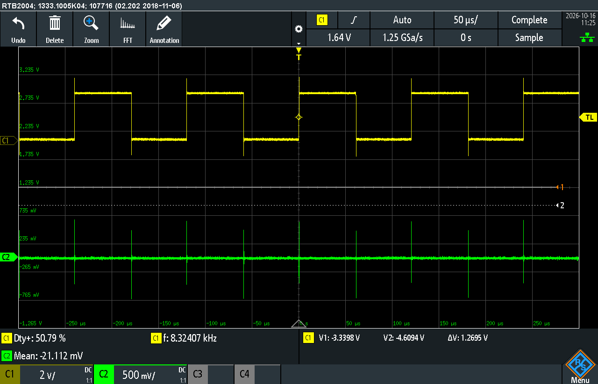


The frequency matches the 120 µs period in the overlay. In reverse the direction pin is high, so the motor is driven while D9 is low and the duty on D9 is inverted (255 − |u|), as in Project 3.

## Step response

The step response was logged with the same PI parameters as in Project 3, Kp = 34 and Ti = 0.03 s, and the same profile: 0 RPM until 1 s, 40 RPM until 8 s, then 60 RPM.


| | Project 3 (Nano) | Project 4 (Nucleo, Zephyr) |
| --- | --- | --- |
| 0 → 40 RPM, settles at | 40.00 RPM | 40.00 RPM |
| Rise time to 90 % | 30 ms | 30 ms |
| 40 → 60 RPM, settles at | 59.71 RPM | 59.72 RPM |
| Rise time to 90 % | 41 ms | 30 ms |
| Overshoot | one encoder count | one encoder count |

The response is the same as in Project 3. The only difference is a slightly faster rise on the second step.

# Part 2: CAN and a reduced CANopen interface

## Part 2.1: CAN bring-up

The Nucleo is connected to the CAN Pal with 3V3, GND, D10 to RX and D2 to TX, and the CAN HAT sits on the Raspberry Pi. CAN_H, CAN_L and GND are wired between the two. The termination is switched on at both ends, measured as 60 Ω between CAN_H and CAN_L. The bus runs at 125 kbit/s. On the Pi the HAT's MCP2515 controller is enabled in `/boot/firmware/config.txt` with the settings from the Waveshare documentation for the 12 MHz crystal, and `can0` is brought up with `sudo ip link set can0 up type can bitrate 125000`.

```text
dtparam=spi=on
dtoverlay=mcp2515-can0,oscillator=12000000,interrupt=25,spimaxfrequency=2000000
```

The `mcp251x` driver reports a 6 MHz CAN clock, which is the 12 MHz crystal divided by two, so the setting matches the board.

The example code from L4.4 sends id 0x123 with 8 bytes every 100 ms, seen with `candump can0`:


After changing the id to 0x456 and the length to 4 bytes:

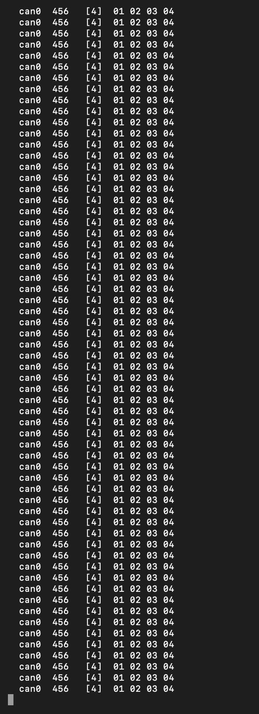

Frames sent from the Raspberry Pi with `cansend`, and `candump` filtered on id 0x321. Only the 0x321 frame is shown, while the 0x456 frames from the Nucleo and the 0x322 frame are filtered out.

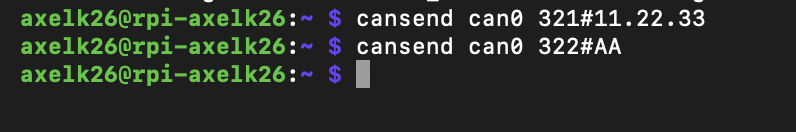


Reception on the Nucleo uses a filter on id 0x321 and a message queue (`CAN_MSGQ_DEFINE()`, `can_add_rx_filter_msgq()`), and the frames are printed from the main loop. The 0x321 frame is received and the 0x322 frame is not:


A frame decoded by the oscilloscope on CAN_H shows id 0x456, DLC 4, data 01 02 03 04, the CRC and the ACK from the Raspberry Pi:


## Part 2.2: Reduced CANopen node

### Architecture

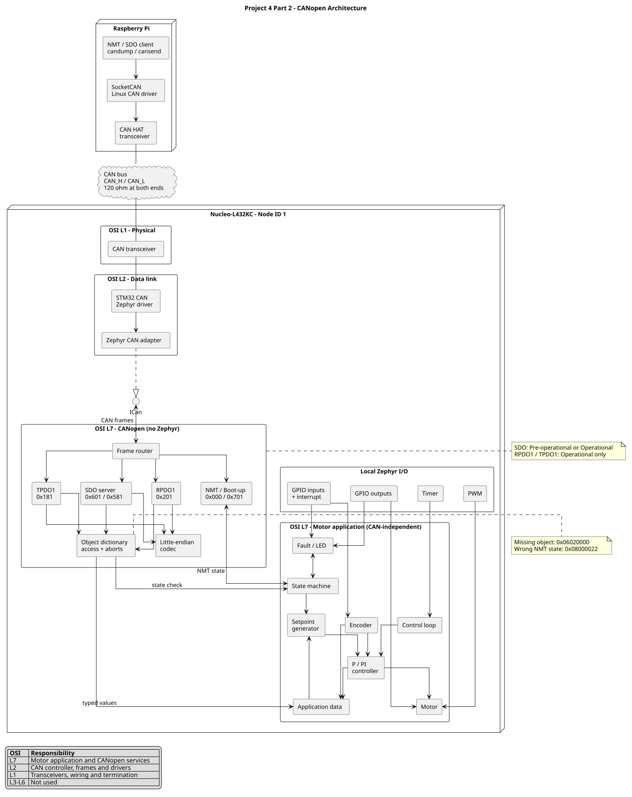

| Layer | OSI | Contents |
| --- | --- | --- |
| Motor application | 7 | state machine, controllers, encoder and motor from Project 3, `MotorApp` |
| CANopen | 7 | NMT, Boot-up, SDO server, RPDO1, TPDO1, object dictionary, little-endian packing (`lib/canopen`) |
| CAN driver | 2 | `ZephyrCan`, which implements the `ICan` interface with the Zephyr CAN driver and the STM32 CAN controller |
| Transceiver | 1 | CAN Pal and CAN HAT, wiring and termination |

CANopen does not use OSI layers 3 to 6. The application does not know about COB-IDs, byte order or the frame format. The CANopen layer reads and writes it through the `NodeApp` interface, which `MotorApp` implements with the Project 3 `Context`, encoder and controllers. The byte packing, the access rules and the abort codes are all in the CANopen layer, in `canopen_node.cpp` and `object_dictionary.cpp`. The CANopen layer has no Zephyr calls and sends and receives frames only through `ICan`. The diagram updated after Part 3 and the design change made along the way are shown in Part 3.1.

### Control task, messages and object dictionary

The control task is speed control of the motor with a 1 ms control update, and the speed and duty cycle are reported on TPDO1 every 10th update. The node has Node ID 1 and implements the services and objects from the brief:

| Service | COB-ID | Direction | NMT states | Content |
| --- | --- | --- | --- | --- |
| NMT | 0x000 | RPi → node | all | command specifier, Node ID (0 = all) |
| Boot-up | 0x701 | node → RPi | on entry to Pre-operational | 1 byte, 0x00 |
| SDO request / response | 0x601 / 0x581 | both | Pre-operational, Operational | expedited upload and download, aborts |
| RPDO1 | 0x201 | RPi → node | Operational | bytes 0–3: target velocity 0x60FF, INTEGER32 RPM |
| TPDO1 | 0x181 | node → RPi | Operational | bytes 0–3: velocity actual 0x606C, INTEGER32 RPM; bytes 4–5: duty cycle 0x2010, INTEGER16 in 0.1 % |

| Index | Name | Type | Access |
| --- | --- | --- | --- |
| 0x1000 | Device type, returns 0x00000192 | UNSIGNED32 | read only |
| 0x2000 | Controller type (0 = P, 1 = PI) | UNSIGNED8 | read/write in Pre-operational |
| 0x2001 | Kp | REAL32 | read/write in Pre-operational |
| 0x2002 | Ti (s) | REAL32 | read/write in Pre-operational |
| 0x2010 | Output duty cycle (0.1 %) | INTEGER16 | read only |
| 0x606C | Velocity actual value (RPM) | INTEGER32 | read only |
| 0x6083 | Profile acceleration (RPM/s, 0 = no limit) | UNSIGNED32 | read/write in Pre-operational |
| 0x6084 | Profile deceleration (RPM/s, 0 = no limit) | UNSIGNED32 | read/write in Pre-operational |
| 0x60FF | Target velocity (RPM) | INTEGER32 | read/write in every state |

A request for an object that does not exist is aborted with 0x06020000, a write to a read-only object with 0x06010002, and a write to a configuration object outside Pre-operational with 0x08000022. The hardware filters on the Nucleo only accept 0x000, 0x601 and 0x201.

### Testing the services

All tests were sent from the Raspberry Pi with `cansend`, and the responses read with `candump can0`.

| Sent | Result |
| --- | --- |
| Reset button | `701 [1] 00`, LED blinks at 1 Hz (Pre-operational) |
| `000#01.01` | LED on (Operational) |
| `000#02.01` | LED blinks at 2 Hz (Stopped) |
| `000#80.01` | LED blinks at 1 Hz (Pre-operational) |
| `000#81.01` (reset node) | `701 [1] 00` |
| `000#82.01` (reset communication) | `701 [1] 00` |
| `000#01.00` (all nodes) | LED on (Operational) |
| `000#80.02` (node 2) | no change |

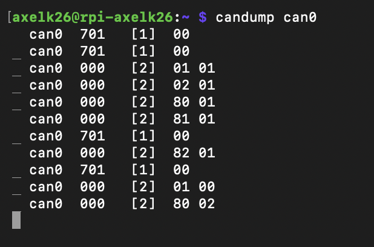

| Test | Request on 0x601 | Response on 0x581 |
| --- | --- | --- |
| Read device type | `40 00 10 00 00 00 00 00` | `43 00 10 00 92 01 00 00` |
| Read Kp (40.0) | `40 01 20 00 00 00 00 00` | `43 01 20 00 00 00 20 42` |
| Write Kp = 34.0 | `23 01 20 00 00 00 08 42` | `60 01 20 00 00 00 00 00` |
| Write Ti = 0.03 | `23 02 20 00 8F C2 F5 3C` | `60 02 20 00 00 00 00 00` |
| Read controller type (PI) | `40 00 20 00 00 00 00 00` | `4F 00 20 00 01 00 00 00` |
| Object that does not exist | `40 00 30 00 00 00 00 00` | `80 00 30 00 00 00 02 06`, abort 0x06020000 |
| Write to read-only object | `23 00 10 00 01 00 00 00` | `80 00 10 00 02 00 01 06`, abort 0x06010002 |
| Write Kp in Operational | `23 01 20 00 00 00 08 42` | `80 01 20 00 22 00 00 08`, abort 0x08000022 |
| Read in Stopped | `40 00 10 00 00 00 00 00` | no response |

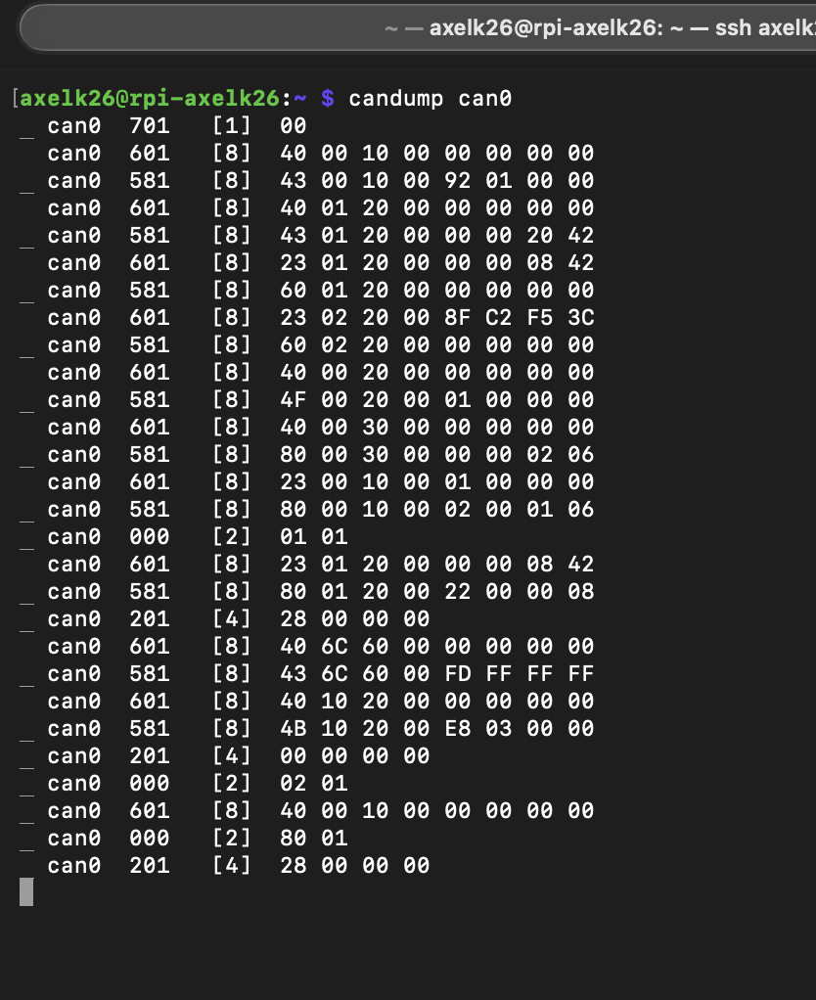

With the node Operational, `201#28.00.00.00` sets the target velocity to 40 RPM. Reading the velocity actual value and the duty cycle back over SDO gives 0x28 = 40 RPM, with 0x2B = 43 RPM one encoder count above, and a duty cycle around 0x1C5 = 45.3 %:

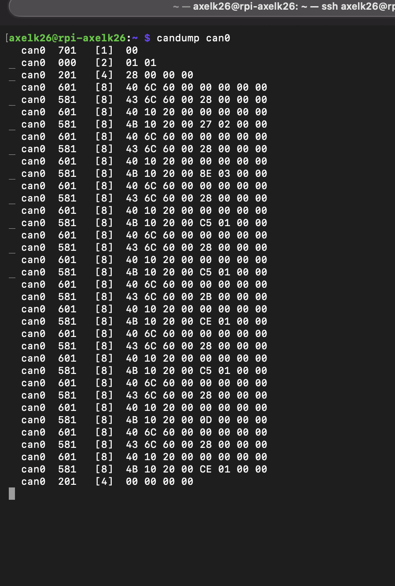

TPDO1 is sent every 10 ms in Operational, with the velocity in bytes 0–3 and the duty cycle in 0.1 % in bytes 4–5 (`candump -td can0,181:7FF`):

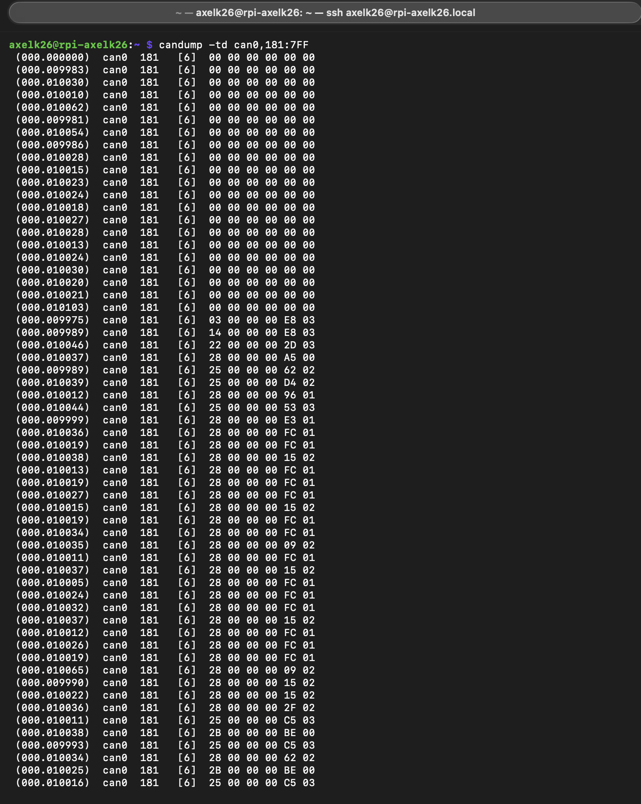

| Service | Pre-operational | Operational | Stopped |
| --- | --- | --- | --- |
| NMT | accepted | accepted | accepted |
| SDO | answered | answered, configuration objects aborted with 0x08000022 | no response |
| RPDO1 | ignored, motor stays still | target velocity set | ignored |
| TPDO1 | not sent | sent every 10 ms | not sent |

### TPDO rate and bus load

TPDO1 is sent on every 10th control update, so at 100 Hz. That is the rate at which the speed measurement changes, since the speed is computed over a 10 ms window.

A standard frame with n data bytes has 47 + 8n bits including the 3 bit interframe space. In the worst case a stuff bit is added after every 4 bits in the 34 + 8n bits from SOF to the CRC, which gives ⌊(33 + 8n)/4⌋ extra bits.

| Frame | Bytes | Bits | Stuff bits (worst case) | Total |
| --- | --- | --- | --- | --- |
| TPDO1 | 6 | 95 | 20 | 115 |
| RPDO1 | 4 | 79 | 16 | 95 |
| SDO request or response | 8 | 111 | 24 | 135 |
| NMT | 2 | 63 | 12 | 75 |

The other frames are sent by the Raspberry Pi. As a worst case RPDO1 is also sent at 100 Hz, plus 10 SDO transfers per second with request and response, while NMT is negligible.

| Frame | Rate | Load |
| --- | --- | --- |
| TPDO1 | 100 Hz | 11.5 kbit/s |
| RPDO1 | 100 Hz | 9.5 kbit/s |
| SDO | 10 transfers/s | 2.7 kbit/s |
| Total | | 23.7 kbit/s |

That is 19 % of 125 kbit/s. At 100 % load the minimum bitrate would be 23.7 kbit/s. With the usual limit of about 50 % bus load it is 47.4 kbit/s, so the lowest standard bitrate that works is 50 kbit/s.

The bus load was measured with `canbusload -t -b -r -e can0@125000` with only TPDO1 on the bus:


It shows 100 frames/s and 10207 bit/s, so 8 % load. That is about 102 bits per frame, between 95 without stuffing and the worst case of 115, so the calculated 11.5 kbit/s works as an upper bound.

### Parameters over SDO and target on RPDO1

In Pre-operational, Kp = 34 and Ti = 0.03 s were written over SDO to 0x2001 and 0x2002. Then the node was set Operational and 40 RPM sent on RPDO1. On TPDO1 the speed goes from 0 to 0x28 = 40 RPM in about 40 ms and then stays at 37–43 RPM, one encoder count either way, and the duty cycle settles around 0x1FC = 50.8 %, as in the TPDO1 screenshot above.

# Part 3: Native Zephyr and the Linux control application

## Part 3.1: Using the RTOS

### Task design

| Task | Trigger | Period / deadline | Zephyr mechanism | Priority |
| --- | --- | --- | --- | --- |
| Encoder count | C1 edge, both edges | edges at least 359 µs apart at the 79.6 RPM maximum | GPIO callback (ISR) | interrupt |
| Speed sample and control release | `k_timer` expiry | 1 ms | timer expiry function (ISR): `sample_speed()`, `k_sem_give(&control_sem)` | interrupt |
| CAN reception | frame passes a hardware filter | sporadic, up to about 1000/s under `cangen` | CAN driver ISR puts the frame in `CAN_MSGQ_DEFINE(can_rx_msgq, 16)` | interrupt |
| Control update: fault check and state machine `step()` with setpoint generator, PI, PWM and LED | `control_sem` | 1 ms, must finish before the next tick | thread `controller_task`, 1024 B stack | 1, preemptive |
| CAN processing: NMT, SDO server, RPDO1 | frame in the message queue | sporadic, SDO answers well within the client's 500 ms timeout | main thread, `node.process()` blocks on `k_msgq_get()` | 3, preemptive |
| TPDO1 send | every 10th control update in Operational | 10 ms | `k_work` on the system work queue | 4, preemptive |
| Boot-up send | exit from Initialization | sporadic | `k_work` through the `on_boot_up` callback | 4, preemptive |
| Console output | `LOG_INF()`, `LOG_ERR()` | best effort | deferred logging, printed by the logging thread | logging thread, low |

The encoder uses a GPIO callback rather than polling. An edge can come every 359 µs at full speed, and the callback costs about 8 µs per edge, 4.64 µs latency plus 3.62 µs body from Part 1, so no pulses are missed. Polling would need a timer interrupt much faster than the control rate.

The control update is released by a periodic `k_timer` through a semaphore and runs in a thread, rather than in the timer ISR or in a loop with `k_msleep(1)`. State changes are not allowed in interrupt context, and the state machine runs in `step()`. `k_msleep()` is relative, so the period would drift by the execution time, while the periodic `k_timer` keeps an absolute 1 ms grid. The ISR only takes the short speed sample, so the sample is taken at exact 1 ms intervals, and gives the semaphore.

CAN processing runs in the main thread, which blocks on the message queue, rather than in the receive callback or a new thread. The callback runs in interrupt context, where frame processing and NMT state changes are not allowed. `main()` has nothing else to do after start-up, and using it saves a thread stack, which Assignment 2.2 measured at about 1.2 kB RAM per thread.

TPDO1 and Boot-up are sent from the system work queue and not from the control thread. `can_send()` waits up to 10 ms for a free TX mailbox, which would break the 1 ms control period on a busy bus. The control thread only pays for `k_work_submit()`. Console output uses deferred logging for the same reason: `LOG_INF()` in the state classes only queues a message, and the UART output happens in the logging thread.

### Shared data

| Data | Writers | Readers | Protection |
| --- | --- | --- | --- |
| Encoder position `pos` | C1 ISR | timer ISR | aligned 32-bit word, atomic load and store on the Cortex-M4 |
| Speed `speed_rpm` | timer ISR | control thread, CAN thread, work queue | `irq_lock()` in `get_speed()`, as in Part 1 |
| Tick counter `counter`, `ms_since_start` | timer ISR | control thread, which also resets `counter` | none. The thread reads and resets `counter` right after the tick that released it, 1 ms before the next increment |
| Application state: `Context` and current state, controllers, setpoint generator, target `ref_speed`, `pwm_value` | control thread, CAN thread | control thread, CAN thread, work queue | `app_mutex` |
| Received CAN frames | CAN driver ISR | CAN thread | `k_msgq`, 16 frames |
| Control release | timer ISR | control thread | `k_sem` with max count 1 |
| TPDO1 and Boot-up requests | control thread | work queue | `k_work` |

The control thread locks `app_mutex` around `fault()` and `step()`, and every `MotorApp` function used by the CANopen layer locks it too. The critical sections are short, so the control thread never waits long for the mutex.

### Priorities and time slicing

All threads are preemptive and have different priorities: control 1, CAN 3 and work queue 4, with the logging thread below. Assignment 2.2 showed that a cooperative thread cannot be preempted until it blocks or yields. The system work queue is therefore moved from its default cooperative priority to preemptive 4 (`CONFIG_SYSTEM_WORKQUEUE_PRIORITY=4`), since a cooperative work queue waiting for a TX mailbox would delay the control thread. The main thread is moved from its default 0 to 3 (`CONFIG_MAIN_THREAD_PRIORITY=3`) for the same reason, so the control thread always preempts CAN processing. Assignment 2.2 also showed that time slicing only rotates threads of equal priority. With all priorities different it has no effect here and is left at the Zephyr default. A context switch measured about 4.7 µs in Assignment 2.2. That cost is the same every period, so it appears as a constant offset and not as jitter.

### State machine and tasks

The state machine from Project 3 is still the only place where the NMT state is decided. NMT commands arrive in the CAN thread and call `MotorApp` functions such as `nmt_start()`, which call the `Context` events under `app_mutex`, so entry and exit actions run in the CAN thread. The control thread calls `step()` every 1 ms, which runs the current state's `on_step()`: the setpoint generator, PI controller and PWM in Operational, and the LED blinking in Pre-operational and Stopped. Faults are also checked by the control thread, which calls `context.fault()` when FLT is low. `Initialization::on_exit()` requests the Boot-up message through the `on_boot_up` callback, which submits a work item, so the state classes do not depend on CAN. The CANopen layer reads the state through `MotorApp::nmt_state()` for the SDO access rules and to only handle PDOs in Operational.

| Requirement | How it is met |
| --- | --- |
| Fixed control rate, not affected by CAN traffic or console output | periodic `k_timer`, highest thread priority, sends in the work queue, deferred logging. Measured jitter is about 1 µs with the bus idle and 39 µs peak-to-peak at 78 % bus load, with no updates lost |
| No encoder pulses missed at maximum speed | GPIO callback, about 8 µs per edge against at least 359 µs between edges |
| No CAN frame processing or change of controller state in interrupt context | the ISRs only count, sample the speed, give the semaphore and queue frames |
| Control task body uses only application classes | `controller_task` only calls `enc` and `context`, plus the semaphore, mutex and work calls |
| TPDO1 every Nth control update in Operational | every 10th update, 100 Hz, nothing sent outside Operational |
| LED indicates the NMT state | on in Operational, 1 Hz in Pre-operational, 2 Hz in Stopped |
| Console output through the logging subsystem | `LOG_MODULE_REGISTER()` in `main.cpp` and `nmt_states.cpp`, `LOG_INF()` for Boot-up, Kp, Ti and control law, `LOG_ERR()` for CAN init, no `printk()` left |

### Updated architecture and resource allocation

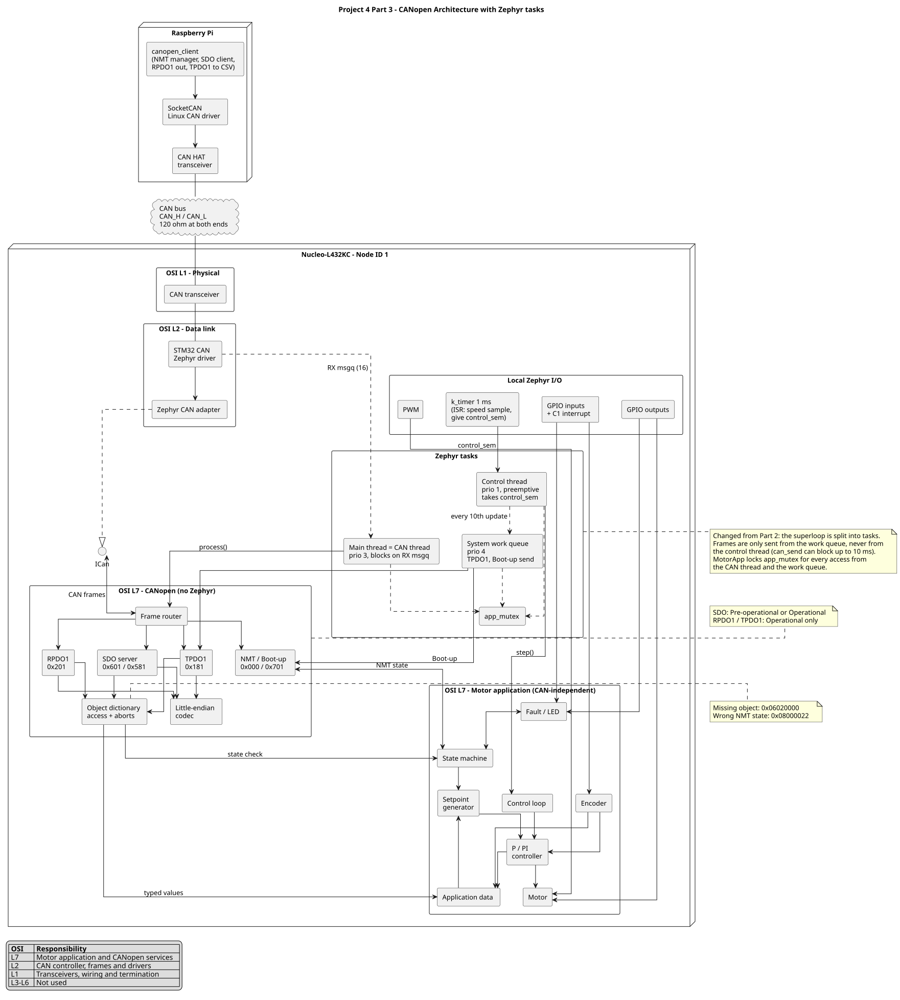

The main design change from Part 2 is where frames are sent. In Part 2 the superloop called `node.on_control_tick()` right after `context.step()`, so TPDO1 and Boot-up were sent directly in the control path. With the control update in its own thread this would have let `can_send()` block the control loop for up to 10 ms, so the sends were moved to the work queue. At the same time every `MotorApp` function got `app_mutex`, since the CAN thread and the work queue now reach the application concurrently with the control thread.

| Resource | Use |
| --- | --- |
| TIM1 channel 1 (PA8) | motor PWM, 8.33 kHz |
| `k_timer` | 1 ms control tick |
| EXTI on PB7 | encoder C1, both edges |
| CAN1 (PA11, PA12) | 125 kbit/s, three hardware filters (0x000, 0x601, 0x201), RX queue of 16 frames |
| Threads | control thread (1024 B stack, priority 1), main and CAN thread (3), system work queue (4), logging thread |
| Memory | RAM 10853 B of 64 KB (16.6 %), flash 49440 B of 256 KB (18.9 %) |

Compared with the Part 1 port at 7.9 % RAM and 11.4 % flash, the increase comes from the CANopen layer, the CAN driver, the logging subsystem and the extra thread stacks.

### Setpoint generator

The setpoint generator in `lib/controllers/setpoint_generator.cpp` has an interface in the style of the controllers: `update(target)` returns the new reference, `reset()` clears it, and `acc` and `dec` are public members in RPM/s. It runs in the control thread in `Operational::on_step()`, where `ref = setpoint.update(enc.ref_speed)` is passed to the controller. It shares the target velocity, written by the CAN thread from RPDO1 or SDO 0x60FF, and the acceleration and deceleration limits, written from SDO 0x6083 and 0x6084 in Pre-operational. All of these are protected by `app_mutex`. Its reference is reset on entry to Operational.

It was developed with TDD. The tests in `test/test_setpoint/test_main.cpp` use dt = 1 ms and acc = dec = 1000 RPM/s, so the reference moves 1 RPM per update. They were written first and then the generator was implemented.

| Test | Checks |
| --- | --- |
| `test_limit_reached` | ramps 1 RPM per update towards a 5 RPM target and stops exactly at it, with no overshoot |
| `test_target_reversed_during_ramp` | after ramping up to 10 RPM, a target of 0 moves the reference down by the deceleration limit of 2 RPM per update |
| `test_zero_limit_is_step` | with acc = dec = 0 the reference jumps straight to the target and back |
| `test_deceleration_through_zero` | from +3 towards −3 it slows down by the deceleration limit, stops at exactly 0, then speeds up the other way by the acceleration limit |

Before the implementation all four tests fail:

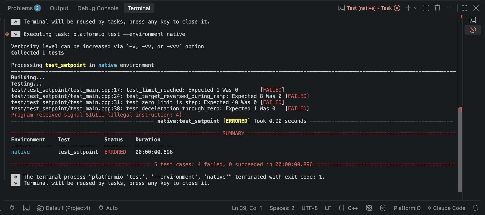

After the implementation all four pass:

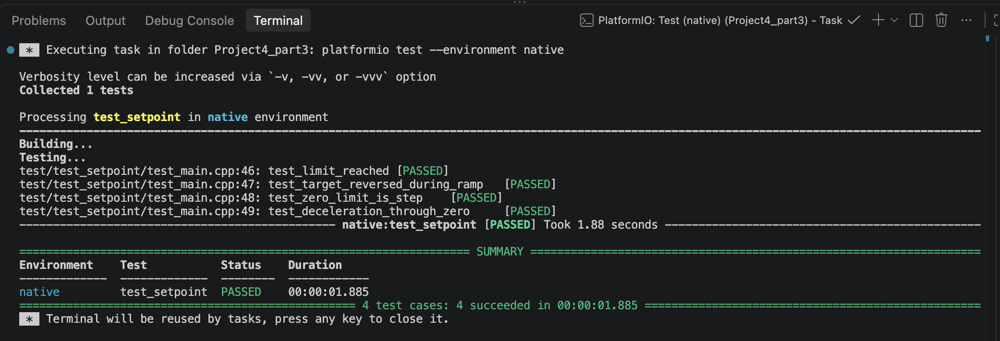

### Target sequence 0 → v → 0

The target sequence was sent with the Linux client from Part 3.2, which sets the acceleration and deceleration limits over SDO. The target was 0 until 1 s, 40 RPM until 4 s and then 0 until 6 s, with Kp = 34 and Ti = 0.03 s. One run used no limit, which gives a true step, and one used 100 RPM/s. 100 RPM/s gives a 0.4 s ramp, while 1000 RPM/s would only give 40 ms, about the motor's own rise time. The setpoint generator's reference is not sent on TPDO1, so the plot reconstructs it from the target and the limit.

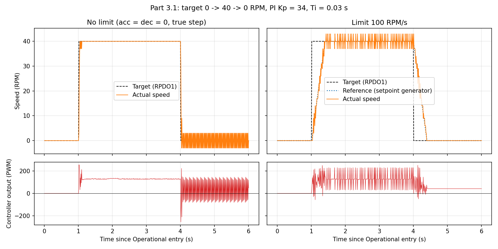

| | No limit (true step) | 100 RPM/s |
| --- | --- | --- |
| 0 → 40 RPM | 30 ms | 371 ms (ramp 400 ms) |
| 40 → 0 RPM | 50 ms to the first 0, then hunts ±1 count around 0 | 381 ms, then stays at 0 |
| Mean \|target − speed\| in the 1 s after each change | 1.90 RPM | 8.32 RPM |
| Mean \|reference − speed\| in the 1 s after each change | 1.90 RPM | 1.01 RPM |
| PWM range | −255 to 255 | −57 to 252 |
| Samples at the PWM limit | 3 | 0 |

Without the limit the controller saturates on both steps, at full positive output on the way up and full negative output on the way down, where it drives the motor backwards to brake. With the limit it never saturates. It follows the ramp to within about one encoder count, and the output only reaches −22 % when slowing down. The error to the target is larger with the limit, 8.3 RPM against 1.9 RPM, because the reference deliberately lags the target. The error to the reference is what the controller sees, and that is smaller than for the step.

After the true step down, the speed overshoots through 0 to −3 RPM and then hunts between −3, 0 and +3 RPM for the rest of the run, with the PWM swinging about ±80. This is the same quantisation limit cycle as in Project 3: one count of error times Kp = 34 is about 100 PWM, enough to break the static friction in either direction. With the ramp the motor reaches 0 slowly, static friction holds it, and it stays still. The output then stays at 16.6 % with the speed at 0, since the error is 0 and the integral keeps its last value, which is too small to overcome the static friction.

### Higher inertia test

The higher inertia test was not done. Part 3 took a long time, and we were running out of time. There were no weights or scale available in the lab that we could find, so we would have had to improvise a weight of unknown mass. We felt the remaining time was better spent on the Linux control application in Part 3.2.

### Jitter of the control update

D11 is toggled at the start of every control update, right after `k_sem_take(&control_sem)` in `controller_task`. The control period is 1 ms, so D11 is a 500 Hz square wave and every half-period is one control interval. The oscilloscope measured the positive and negative pulse widths with statistics over about 10 s per run. The node was Operational with target 0, so the control loop and TPDO1 ran as normal with the wheel still.

The bus was loaded with `cangen can0 -g 1 -I 201 -L 4 -D 00000000`. Plain `cangen` with random ids was not used, since random ids can hit NMT, RPDO1 or SDO and change the state of the node, and all other ids are dropped by the hardware filter, so the CPU would never see them. RPDO1 frames with target 0 pass the filter and go through the CAN receive ISR, the message queue and the CAN thread about 1000 times per second without changing what the motor does. `canbusload` showed 1007 frames/s and 97665 bit/s, which is 78 % load:

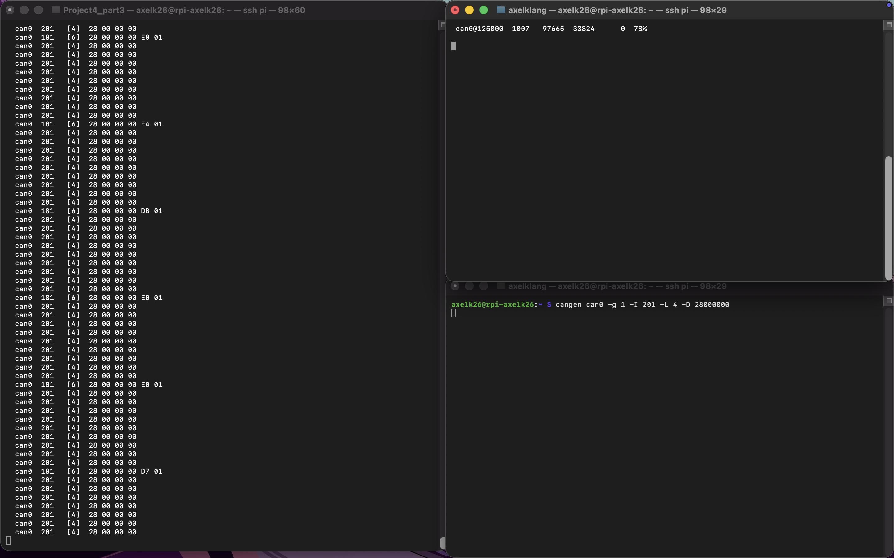

| Run | Measurement | Min | Max | Mean | Std dev | Peak-to-peak | Count |
| --- | --- | --- | --- | --- | --- | --- | --- |
| Idle | PW+ | 1.000960 ms | 1.001926 ms | 1.001396 ms | 0.177 µs | 0.97 µs | 409 |
| Idle | PW− | 1.000822 ms | 1.002018 ms | 1.001384 ms | 0.175 µs | 1.20 µs | 410 |
| 78 % load | PW+ | 981.916 µs | 1.020510 ms | 999.738 µs | 5.64 µs | 38.6 µs | 336 |
| 78 % load | PW− | 982.192 µs | 1.020602 ms | 1.001494 ms | 5.60 µs | 38.4 µs | 336 |

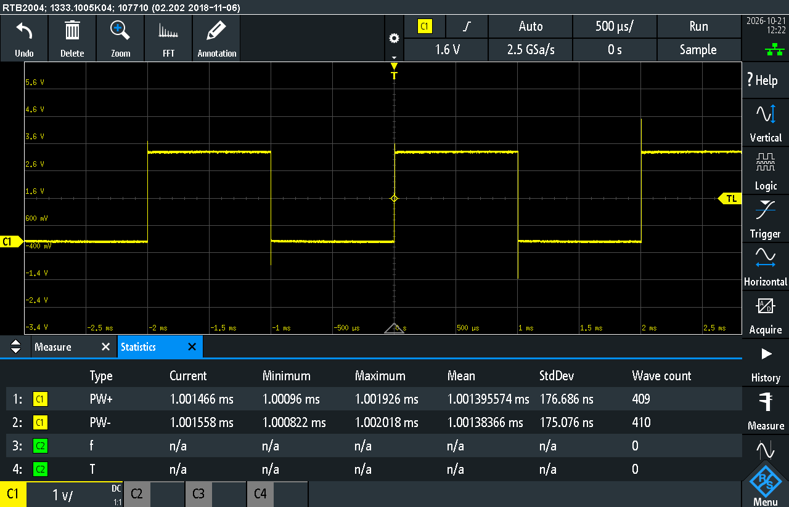

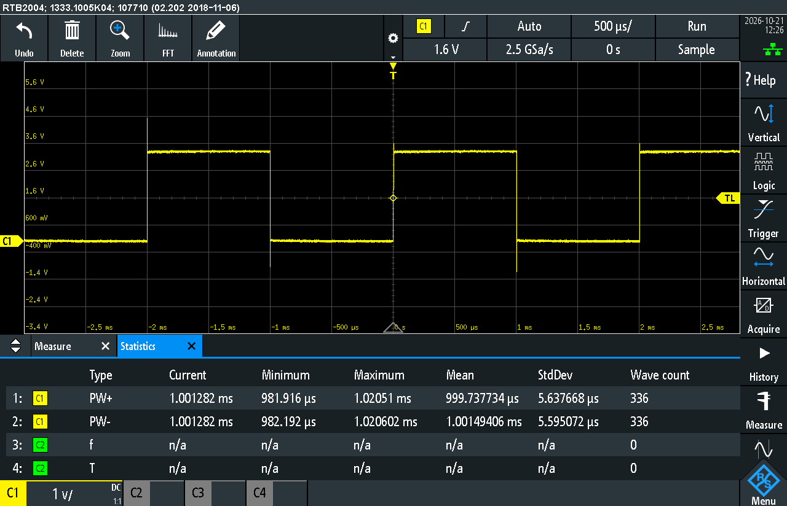

With the bus idle the jitter is about 1 µs peak-to-peak. Under load it grows to about 39 µs peak-to-peak, and the standard deviation from 0.18 µs to 5.6 µs. The mean stays at 1.000–1.001 ms, so updates are shifted in time but not skipped. An update that comes late is followed by a shorter interval, which is why the minimum and maximum lie symmetrically around 1 ms. The idle mean of 1.0014 ms is 0.14 % above nominal in both pulse widths, which is a constant offset in the timer clock and not jitter. The CAN thread has lower priority than the control thread and cannot delay it, so the extra jitter most likely comes from interrupt-level work: the CAN receive ISR and message queue run about 1000 times per second and can delay the timer ISR that gives the semaphore. Even under load the worst case of about 20 µs is 2 % of the control period.

To check for lost frames, TPDO1 was counted on the Pi for 10 s with `timeout -s INT 10 candump -ta can0,181:7FF`, with the bus idle and under load.

| Run | Frames in 10 s | Mean gap | Min gap | Max gap |
| --- | --- | --- | --- | --- |
| Idle | 999 | 10.014 ms | 9.967 ms | 10.067 ms |
| 78 % load | 998 | 10.015 ms | 9.733 ms | 10.710 ms |

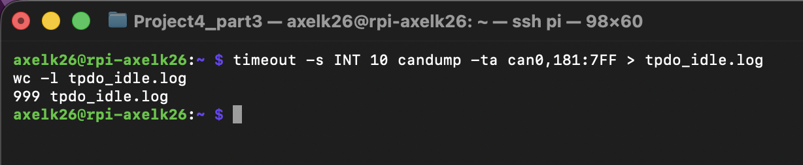

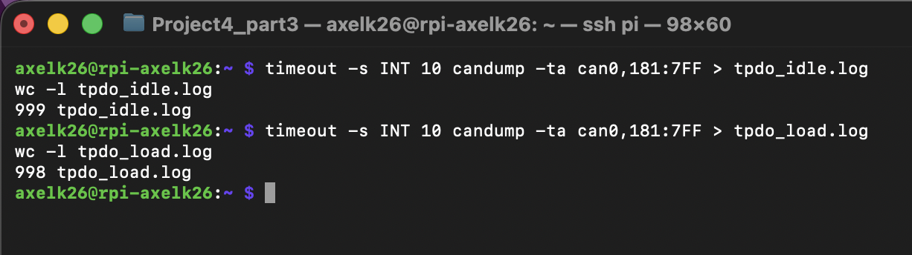

No TPDO1 frames are lost under load. A lost frame would show as a gap of about 20 ms, and the largest gap is 10.7 ms. The extra spread fits arbitration. TPDO1 at 0x181 has higher priority than the flood frames at 0x201, so it always wins arbitration, but it may have to wait for a 0x201 frame that is already on the bus. A 4 byte frame takes 79–95 bits, which is 0.63–0.76 ms at 125 kbit/s and matches the 0.7 ms longest extra delay.

## Part 3.2: Linux control application

### Implementation

The client is `rpi/canopen_client.c`, built from the given skeleton and compiled on the Pi with `gcc -Wall -O2`. It is run as `./canopen_client can0 <log.csv> [limit]`, where the optional limit sets the profile acceleration and deceleration in RPM/s, with a default of 1000. It runs these steps:

1. Send NMT reset node and wait up to 3 s for the Boot-up message. The brief says to wait for the Boot-up and only reset if none arrives. Resetting first means that every run starts from the same known state, whatever an earlier run or a manual `cansend` left behind, and the Boot-up then always arrives within the timeout. If the reset frame cannot be sent, no Boot-up arrives and the client stops with `boot-up: timeout`.
2. Read the device type 0x1000, which returns 0x00000192.
3. In Pre-operational, write the controller type (PI), Kp = 34, Ti = 0.03 s and the acceleration and deceleration by SDO download, and read each value back by SDO upload to verify it. REAL32 values are sent and compared as their IEEE 754 bit pattern, for example 34.0 = 0x42080000, so the comparison is exact. The controller type is written first, since the Kp read-back returns the Kp of the active controller.
4. Set the node Operational.
5. Send the target velocity on RPDO1, 0 for 4 s, 40 RPM for 4 s and then 0 for 4 s. Every TPDO1 is logged to the CSV file as time, target, speed and duty cycle, time-stamped with `CLOCK_MONOTONIC` right after reception.
6. On exit, on a TPDO1 timeout of 100 ms or on Ctrl-C, send target 0 on RPDO1 while the node is still Operational and then NMT Pre-operational. The order matters, since RPDO1 is ignored outside Operational.

Every SDO and NMT call is checked, and timeouts, I/O errors, unexpected responses and SDO abort codes are printed with a clear message. Sample output:

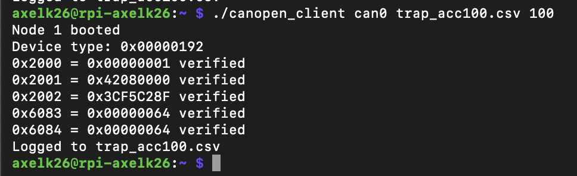

To test the abort handling, an NMT start was sent before the configuration. The first write then fails with `write 0x2000: SDO abort 0x08000022`, so the configuration objects are locked outside Pre-operational as they should be.

The Ctrl-C handler only sets a `volatile sig_atomic_t` flag that the main loop checks. Ctrl-C also interrupts `poll()` in the receive function, so the loop exits at once. In `candump` the last frames are `201 [4] 00 00 00 00` and `000 [2] 80 01`, after which TPDO1 stops:

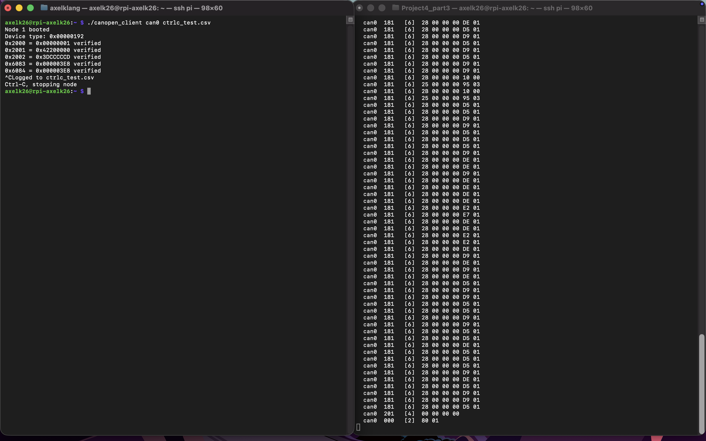

The step and load runs below were logged with an earlier timing of the same client: a single step from 0 to 40 RPM at 1 s with the limit at 1000 RPM/s, and a 20 s run to leave time for the load. The 0 → v → 0 runs in Part 3.1 used target changes at 1 s and 4 s. The final 4 s phases were chosen for the video so that each phase is easy to see.

### Step response

The step response uses the same controller parameters as in Project 3, Kp = 34 and Ti = 0.03 s. The duty cycle is converted to PWM counts to share the axis with the Project 3 log.

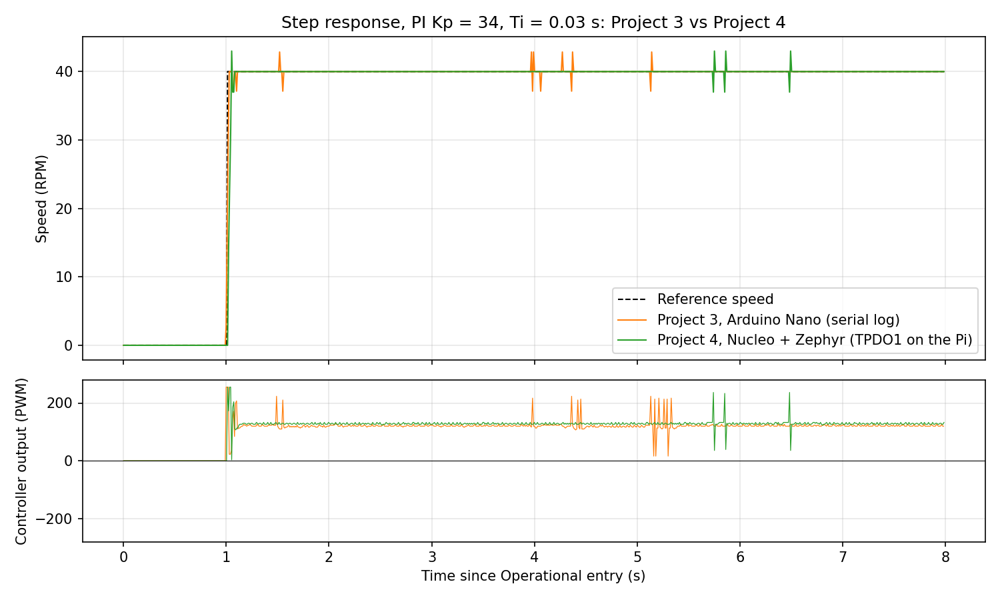

| Run | Rise time to 90 % | Max | Steady state 2–8 s | Std dev |
| --- | --- | --- | --- | --- |
| Project 4, 1000 RPM/s ramp, logged from TPDO1 | 40 ms | 43.0 RPM | 40.00 RPM | 0.30 RPM |
| Project 4, true step, logged from TPDO1 | 30 ms | 40.0 RPM | 40.00 RPM (2–4 s) | 0.00 RPM |
| Project 3, true step, serial log | 30 ms | 42.9 RPM | 40.00 RPM | 0.35 RPM |

With the 1000 RPM/s limit the rise takes 40 ms, which is exactly the ramp from 0 to 40 RPM, so the motor follows the reference. The true step from the 0 → v → 0 run is the same kind of step as in Project 3 and gives the same 30 ms rise time. The steady state is 40.00 RPM in all runs, so the PI controller removes the steady-state error, and the overshoot is at most one encoder count. The steady-state PWM is about 128 in Project 4 against about 122 in Project 3, which is within the run-to-run variation in friction. The duty cycle jumps whenever a sample reads one count off. The speed resolution at a 10 ms window is 2.86 RPM, and one count times Kp = 34 is a large step in the output.

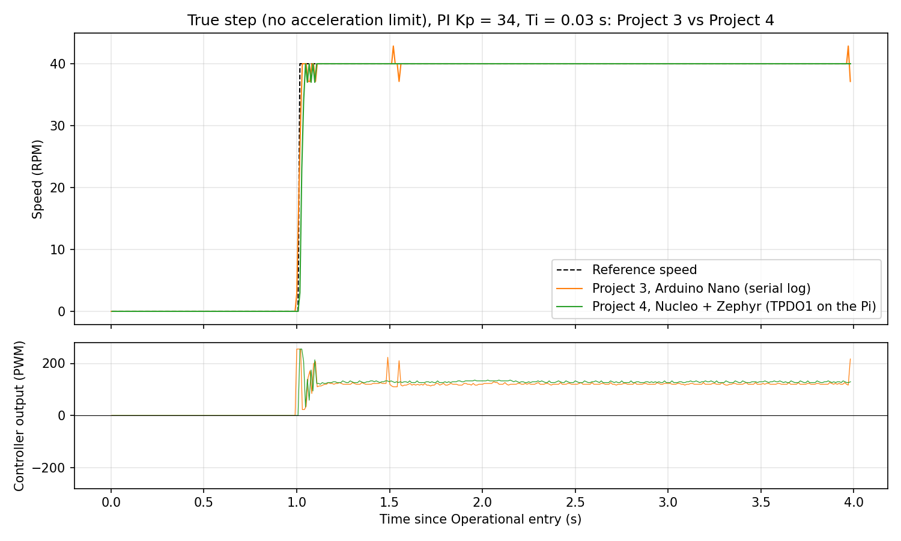

### Load response

The load was applied by braking the shaft by hand from about 6 s to 12 s, as in Project 3.

| Interval | Mean speed | Mean duty | Samples at 100 % duty |
| --- | --- | --- | --- |
| 2–6 s, no load | 40.0 RPM | 50.0–50.4 % | 0 |
| 6–12 s, load | 39.3–39.7 RPM | 62–70 % | 6–25 per second, single samples |
| 13–20 s, released | 40.0 RPM | 50.2–50.6 % | 0 |

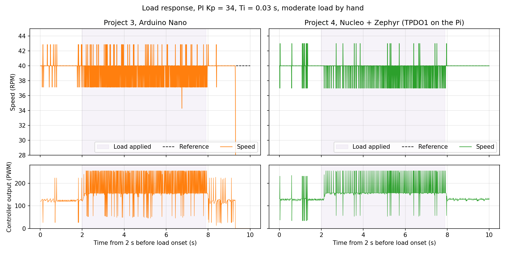

The PI controller holds the mean speed within half an encoder count of the reference under load, with the extra output coming from the integral. After release it returns to 40 RPM with no visible overshoot. The output only reaches 100 % in single samples when the speed reads one count low, so it never saturates continuously. Project 3 with a moderate load went from about 48 % to 73 % at 39.0–39.3 RPM, so the two behave almost the same. The Project 3 trace drops to 0 at about 9.3 s because that run was stopped there.

### Jitter on the Linux side

| Log | Rows | Mean interval | Min | Max | Std dev |
| --- | --- | --- | --- | --- | --- |
| Step run | 1998 | 10.014 ms | 9.905 ms | 10.109 ms | 12 µs |
| Load run | 1998 | 10.013 ms | 9.901 ms | 10.143 ms | 15 µs |

The time stamps in the client log spread about ±0.1 ms around the 10 ms TPDO period. The kernel time stamps from `candump` on an idle bus spread 9.967–10.067 ms, about half as much. The control loop on the node jitters by only about 1 µs, so the spread comes from TPDO1 being sent from the work queue on the node and from reception on the Pi. The part added by the Linux user space is about ±0.05 ms on top of the kernel time stamps. That is 0.5 % of the TPDO period, small enough not to matter for logging at 100 Hz. The mean of 10.014 ms instead of 10 ms matches the 1.0014 ms control period measured on the scope, since TPDO1 is sent every 10th update.

## Part 3.3: Optional features

The optional features were not done. By this point time was running very short, and we needed to finish Parts 3.1 and 3.2, the video and the report.

# Video and code

The video is in two parts:

1. Part 1, the port to Zephyr with the keyboard interface: <https://youtube.com/shorts/efe7f53iNW0>. The node starts in Pre-operational, the control law is set to P and the node is set Operational. After a reset the control law is set to PI with Kp = 34 and Ti = 0.03 s, and the node is set Operational again. The fault button stops the motor, and setting the node Operational restarts it. At the end a stopwatch times one revolution at about 2 s, which matches the 30 RPM shown by the speed measurement.
2. Part 3.2, the Linux client over CAN: <https://youtube.com/shorts/omiR3ibQbaE>. The client boots and configures the node over SDO, sets it Operational and runs the target 0 → 40 → 0 RPM with the 100 RPM/s limit, and returns it to Pre-operational. A second run is stopped with Ctrl-C.

The code for both the Nucleo and the Raspberry Pi is in <https://github.com/A-Klang/Projects_EmbeddedRU>, in `Project4_part3/` and `Project4_part3/rpi/`. The README there shows where each part is.
